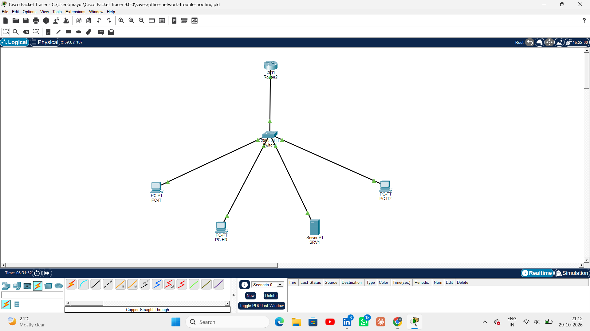

# Small Office Network Configuration & Troubleshooting Lab

A hands-on networking project built using **Cisco Packet Tracer** to design, configure, test, and troubleshoot a small office network.

## Project Overview

This project simulates a small office network with separate IT, HR, and Server departments. It demonstrates VLAN segmentation, inter-VLAN routing, trunk configuration, DHCP, DNS, HTTP services, and systematic network troubleshooting.

The objective was to build a functional network, deliberately introduce common configuration failures, identify their root causes, implement fixes, and verify connectivity.

## Network Topology

**Devices used:**
- 1 × Cisco 2911 Router (R1)
- 1 × Cisco 2960 Switch (S1)
- 2 × IT Department PCs
- 1 × HR Department PC
- 1 × Server (SRV1)

**Network architecture:**
- Router-on-a-stick configuration for inter-VLAN routing.
- IEEE 802.1Q trunk between the router and switch.
- Separate VLANs for IT, HR, and Servers.
- Centralized DHCP configuration on the router.
- DNS and HTTP services hosted on the server.



## Network Addressing & VLAN Configuration

| Department | VLAN | Network | Default Gateway |
|---|---:|---|---|
| IT | 10 | 192.168.10.0/24 | 192.168.10.1 |
| HR | 20 | 192.168.20.0/24 | 192.168.20.1 |
| Servers | 30 | 192.168.30.0/24 | 192.168.30.1 |

### Switch Port Allocation

| Switch Port | Connected Device | VLAN |
|---|---|---:|
| Fa0/2 | PC-IT | 10 |
| Fa0/3 | PC-IT2 | 10 |
| Fa0/4 | PC-HR | 20 |
| Fa0/5 | SRV1 | 30 |
| Gi0/1 | R1 G0/0 | Trunk |

### IP Address Allocation

Client devices obtain their addresses through DHCP.

The server uses a static address:

- IP address: `192.168.30.10`
- Subnet mask: `255.255.255.0`
- Default gateway: `192.168.30.1`
- DNS server: `192.168.30.10`

## Technologies & Concepts Used

- Cisco Packet Tracer
- Cisco IOS CLI
- VLAN configuration and segmentation
- IEEE 802.1Q trunking
- Router-on-a-stick
- Inter-VLAN routing
- DHCP pools and address allocation
- DNS A records and hostname resolution
- HTTP service configuration
- IPv4 addressing and subnetting
- Network connectivity testing and troubleshooting

## Implementation

### 1. VLAN Configuration

Created three VLANs to separate departmental traffic:

- VLAN 10 – IT
- VLAN 20 – HR
- VLAN 30 – Servers

Assigned switch access ports to their respective VLANs and configured the router-facing switch port as a trunk.

### 2. Inter-VLAN Routing

Configured router subinterfaces on R1:

| Interface | VLAN | IP Address |
|---|---:|---|
| G0/0.10 | 10 | 192.168.10.1 |
| G0/0.20 | 20 | 192.168.20.1 |
| G0/0.30 | 30 | 192.168.30.1 |

Used 802.1Q encapsulation to route traffic between the VLANs.

### 3. DHCP Configuration

Configured separate DHCP pools for IT, HR, and Servers.

Each pool specifies:
- Network address and subnet mask
- Default gateway
- DNS server

Excluded gateway and reserved address ranges to prevent the DHCP server from assigning those addresses to clients.

### 4. DNS and HTTP Configuration

Configured SRV1 with:
- DNS service enabled
- A record: `intranet.office.local`
- IP mapping: `192.168.30.10`
- HTTP service enabled

Verified access to the internal webpage using the hostname.

## Troubleshooting Scenarios

Deliberately introduced configuration faults and investigated them using Cisco IOS commands and client-side connectivity tests.

| Incident | Fault introduced | Diagnostic approach | Resolution |
|---|---|---|---|
| Incorrect VLAN assignment | PC connected to the wrong VLAN | `show vlan brief`, ping tests | Corrected access VLAN |
| Incorrect default gateway | Client configured with an invalid gateway | `ipconfig`, gateway ping, remote-subnet ping | Corrected gateway address |
| Trunk configuration failure | VLANs 20 and 30 removed from allowed list | `show interfaces trunk`, inter-VLAN ping tests | Restored allowed VLAN list |
| DHCP allocation failure | IT DHCP pool removed | `show ip dhcp pool`, `show ip dhcp binding` | Recreated IT DHCP pool |
| DNS resolution failure | DNS service disabled on SRV1 | Hostname versus direct-IP browser tests | Restored DNS service and verified the A record |

### Example Troubleshooting Commands

**Switch diagnostics**
```text
show vlan brief
show interfaces trunk
show running-config
```

**Router diagnostics**
```text
show ip interface brief
show ip route
show ip dhcp pool
show ip dhcp binding
show running-config
```

**Client diagnostics**
```text
ipconfig
ping 192.168.20.1
ping 192.168.30.10
```

## Validation & Testing

The following tests were used during implementation and troubleshooting:

- Verified VLAN membership and trunk configuration.
- Tested connectivity between devices in the same VLAN.
- Tested connectivity between different VLANs.
- Verified DHCP address allocation for IT and HR clients.
- Tested reachability to the server using its IP address.
- Tested DNS hostname resolution using the internal intranet hostname.
- Verified recovery after correcting deliberately introduced faults.

## Project Structure

```text
office-network-troubleshooting-lab/
│
├── README.md
├── office-network-troubleshooting.pkt
│
├── screenshots/
│   ├── 01-network-topology.png
│   ├── 02-vlan-trunk.png
│   ├── 03-baseline-connectivity.png
│   ├── 04-intranet-working.png
│   └── ... troubleshooting evidence
│
└── configs/
    ├── R1-running-config.txt
    └── S1-running-config.txt
```

## Learning Outcomes

Through this project, I gained practical experience in:

- Designing and configuring a segmented small-office network.
- Configuring VLANs, trunk links, and inter-VLAN routing.
- Understanding DHCP address allocation and DNS resolution.
- Using Cisco IOS commands to inspect and troubleshoot network configurations.
- Identifying root causes through structured testing rather than random configuration changes.
- Validating network recovery after troubleshooting.

## Future Improvements

- Implement ACLs to control communication between departments.
- Configure OSPF routing in an extended topology.
- Add network monitoring and logging.
- Integrate cloud infrastructure and remote connectivity concepts.

---

**Project Type:** Hands-on Networking Lab  
**Platform:** Cisco Packet Tracer  
**Focus Areas:** Network Configuration | IT Support | Network Troubleshooting | NOC | Cloud Support